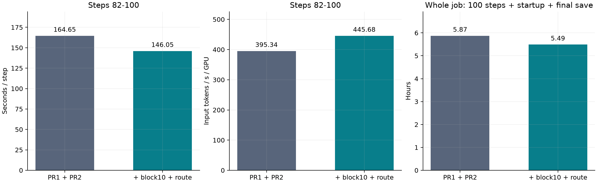
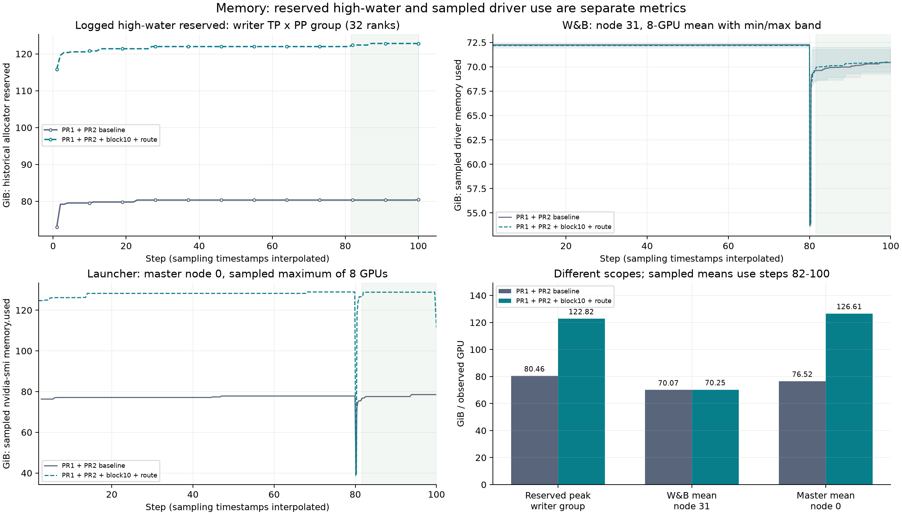

# GLM-5.3-Flash: block10 + packed CP route prebuild

This recipe adds the tested Swift packed-batch entry change on top of the GLM-5.3
runtime in `feat/glm53-flash-support` (base `51111119e21c539c186f481aa8065071e7b9c867`,
including PR #1 TP dedup and PR #2 ReLU/MUL fusion). Route prebuild is opt-in;
block10 uses existing Megatron recomputation arguments. Installing this patch does
not change the recomputation strategy or enable any of the four switches.

## Runtime behavior

After Swift populates `PackedSeqParams`, `MCORE_CP_ROUTE_PREBUILD=1` calls Megatron's
existing `finalize_packed_seq_params(packed)` when `context_parallel_size > 1`.
This resolves the CP group and builds the THD partition route on the microbatch's
metadata. Subsequent zigzag/contiguous conversions reuse that route; another
microbatch receives its own route. CP=1 and unset/disabled switches retain the
original entry behavior. This prepares routing metadata; CP all-to-all still runs.

The patch modifies only `swift/megatron/utils/utils.py`. It adds no Megatron
runtime changes or dependencies. Existing Megatron route caching and the
finalizer are present in the supported upstream commit below.

## Install into a new environment

Supported source pair:

| Component | Commit |
|---|---|
| Swift (`train-infer/ms-swift`) | `07d4ecdaa210ef778d8185be53a7a5b44a843ec8` |
| Megatron (`NVIDIA/Megatron-LM`, dev) | `ee743d3ef228f546287dc3835c2cf56011d5136b` |
| Bridge PR base | `51111119e21c539c186f481aa8065071e7b9c867` |

Install compatible Swift, Megatron and this bridge wheel in an **unused**
environment, then apply patches after all package installations:

```bash
python -m mcore_bridge.tools.apply_megatron_patch
python -m mcore_bridge.tools.apply_megatron_patch --check
python -m mcore_bridge.tools.apply_swift_patch
python -m mcore_bridge.tools.apply_swift_patch --check
```

The new installer ships the full-index Swift diff in the wheel and uses the
existing installer's file validation/publication helpers. It applies in a
scratch directory with zero patch fuzz, verifies every hunk and Python syntax,
then publishes. Partial installation, conflicting context and symlinked targets
are rejected. Repeat application is a verified no-op; `--check` is read-only.
Unrelated edits outside the matched patch context are preserved, including a
source checkout's Git index. This Swift installer does not attempt a Git
three-way merge. Source drift requires a separately regenerated/tested patch.
Publication rollback is best effort, as documented for the existing installer.
Run one installer process before training; never patch from training ranks.

For a source checkout, use its parent containing `swift/`:

```bash
python src/mcore_bridge/tools/apply_swift_patch.py --root /path/to/ms-swift
python src/mcore_bridge/tools/apply_swift_patch.py --root /path/to/ms-swift --check
```

Direct script invocation and installer tests need the Python standard library
and GNU `patch`; module invocation also uses normal bridge package imports.
No Torch training module is imported to locate Swift.

## Enable all four paths

Export in every training rank's environment:

```bash
export MCORE_KPOOL_SELECTION_MODE=tp_dedup
export MCORE_KPOOL_VALIDATE=first
export MCORE_KPOOL_RELU_MUL_FUSION=1
export MCORE_CP_ROUTE_PREBUILD=1
```

Pass these actual arguments to Swift Megatron SFT:

```bash
--recompute_granularity full --recompute_method block --recompute_num_layers 10
```

An environment variable alone does not change Megatron recomputation unless the
launcher explicitly translates it into these arguments. Verify the rendered
rank scripts and effective training arguments before submission. PR #2 fusion
can remain enabled together with TP dedup and route prebuild; disabling it in an
earlier experiment was an attribution choice. Checkpoint selection replay from
PR #3 is outside this recipe and its combined validation.

For the tested 45-HF-block model, bridge expands each attention/FFN block into
two hybrid sublayers, giving 90 Megatron layers. With PP8, stages 0–4 contain
12 sublayers each and stages 5–7 contain 10. `block/10` checkpoints the first
10 sublayers of **each stage**, leaving two uncheckpointed on each of stages
0–4. Uniform/1 checkpoints all 90; block/10 checkpoints 80. These counts apply
to this model and pipeline split, not arbitrary GLM configurations.

## Regression commands

Installer tests require no Torch/CUDA:

```bash
python -m unittest discover -s tests -p test_apply_swift_patch.py -v
python -m unittest discover -s tests -p test_apply_megatron_patch.py -v
```

Set `SWIFT_ROUTE_BASE_FILE` to the complete `utils.py` from the pinned Swift
commit to include the full-source integration case. It checks the patched
Git blob `8908f11a29e40f66cc077ed7476eb796755cab91`, identical to the source
archived from the completed training environment. The unpatched file's SHA-256
is `600f014b9edf0167b3e2bfc92b0ab49d23b2288e5348e20881c3b3eedb680cde`.

With the installed supported stack, exercise the real Swift entry and route
implementation on CPU:

```bash
python tests/glm53_patch_regression/verify_glm53_route_prebuild.py --output route_cpu.json
```

This checks CP2/4/8, single/multiple packed sequences, both conversion directions,
exact output/gradient parity, route identity reuse, new-microbatch isolation and
CP1 behavior. For a separately allocated eight-GPU node:

```bash
mkdir -p route_gpu
python -m torch.distributed.run --standalone --nproc_per_node=8 \
  tests/glm53_patch_regression/verify_glm53_route_prebuild.py --gpu --output route_gpu
```

The distributed check uses TP2/CP4, actual converter collectives, packed inputs
and repeated output/gradient comparisons. Historical training preflight passed
on eight H200 ranks with this route entry change. The newly packaged installer
was checked on source copies and from a built wheel; it has not itself been
rerun in a new full GPU training job.

## Observed 100-step combined-environment result

Baseline `tj-20261018-418b6d` enabled PR #1 + PR #2 with uniform/1. Experiment
`tj-20261019-933e32` enabled PR #1 + PR #2 + block10 + route. Both completed 100
steps on 32 × 8 H200, TP4/PP8/CP8/EP8/ETP1/DP1, GBS64/MBS1, max length 262144,
BF16, MTP0, Adam CPU offload 0.5, LR 1e-5 and seed42. Data preparation used
binpack/padding-free processing and the same initial model/data.

| Metric | PR #1 + PR #2 baseline | + block10 + route | Change |
|---|---:|---:|---:|
| Steps82–100 average interval | 164.65 s | 146.05 s | time −11.30% |
| Steps82–100 input token/s/GPU | 395.34 | 445.68 | throughput +12.73% |
| Full100-step training timer | 20540.51 s | 18834.88 s | −8.30% |
| Job wall time, excluding queue | 21142 s | 19763 s | −6.52% |
| Allocated GPU-hours saved | — | 98.06 | 256 GPUs × wall-time saving |

Intervals are differences of cumulative training time reconstructed from
`step × train_speed(s/it)`. All 19 steps82–100 are retained; this window excludes
the first step and step81 containing checkpoint80 overhead. Input throughput is
316,608,198 nonpadding **input** tokens divided by each window's total elapsed
time and 256 GPUs; it is not supervised-output-token throughput. The input count
comes from archived Arrow lengths and packing/sampler replay, not actual-batch
runtime signatures. Whole-job timing includes startup and final checkpoint.



Memory increases substantially at the early pipeline stage:

| Memory metric (GiB) | Baseline | Combination | Change |
|---|---:|---:|---:|
| Logged historical peak reserved, writer TP×PP group (32 ranks) | 80.460 | 122.820 | +42.360 |
| Node0 (PP0), steps82–100 driver sample mean per GPU | 76.524 | 126.613 | +50.089 |
| Node0, steps82–100 driver sample maximum | 78.522 | 128.819 | +50.297 |
| Node31 (PP7), steps82–100 driver sample mean per GPU | 70.068 | 70.250 | +0.182 |
| Node31, steps82–100 driver sample maximum | 71.776 | 72.029 | +0.254 |

Node0's observed step2–100 sample maximum was 128.937 GiB against 140.401 GiB
reported device capacity, leaving about 11.465 GiB observed headroom. Samples
exclude first-step/final-save peaks and do not cover all 256 GPUs. Reserved
high-water and driver-used sampling measure different scopes. Driver samples
use `step81 completion < timestamp <= step100 completion`, not the last logged
step label. The unchanged recomputation coverage at PP7 and retained activations
at PP0 are consistent with the uneven memory increase; they do not isolate its
complete cause. Neither job logged CUDA OOM.



Loss MAE over the paired 100 steps was 0.00018638, maximum difference 0.00088310;
final loss was 0.49466333 versus 0.49429315 and LR matched exactly. Grad norms
were not identical (MAE0.01606, maximum difference0.28316). Limited synthetic
GPU preflight passed; no full-model tensor parity or downstream quality
evaluation was performed.

This is a **combined rebuilt-environment comparison**, not a block-only or
route-only causal ablation. Among 1,214 Swift/Megatron/bridge Python source files,
only the packed-entry file differed, but Transformer Engine changed
2.19.0→2.20.2, FlashAttention3 changed 3.0.0→3.0.1, and Python changed
3.12.14→3.12.13. Each recipe ran once on different physical GPUs/times. No Nsight
capture was made for these runs. The measured speedup cannot be assigned wholly
to block10/route or used as proof that an individual kernel/collective bottleneck
has disappeared. Use a fixed binary environment and a repeated 2×2
uniform1/block10 × route-off/on experiment for independent attribution.
